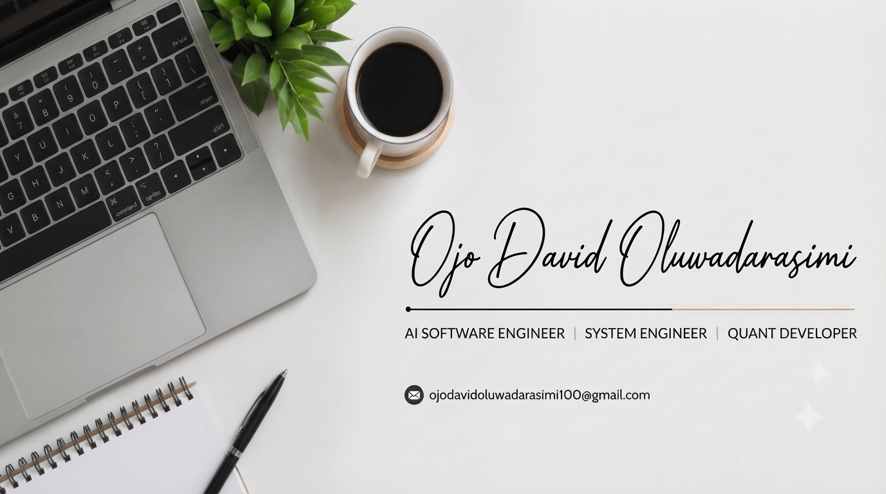

  

**Ojo David Oluwadarasimi**

  

I am passionate about understanding how technology works beneath the surface and using that knowledge to build meaningful digital experiences, intelligent applications and high-performance software systems.

My interests span Artificial Intelligence, Systems Engineering, Quantitative Development and Software Engineering. I enjoy exploring complex technical concepts, solving problems and turning ideas into practical implementations.

I am committed to continuous learning, engineering excellence and building technology that makes a meaningful impact.

---

**About Me**

- Currently pursuing Software Engineering.
- Exploring Artificial Intelligence and Machine Learning.
- Interested in scalable, reliable and high-performance software systems.
- Developing an interest in quantitative computing and financial technology.
- Passionate about algorithms, problem-solving and software architecture.
- Building projects to turn technical knowledge into practical experience.
 
---

**Areas of Interest**

| Field | Focus |
|-------|-------|
| **Artificial Intelligence** | Machine learning, intelligent applications and AI-powered solutions |
| **Systems Engineering** | Operating systems, distributed systems, performance and scalability |
| **Quantitative Development** | Algorithms, mathematical computing and financial technology |
| **Software Engineering** | Software architecture, clean code and problem-solving |
| **Web Development** | Responsive, functional and engaging digital experiences |

---

### Tech Stack:

                  

Currently Strengthening

- Data Structures and Algorithms
- Object-Oriented Programming
- Database Management and SQL
- Operating Systems and Computer Networks
- Backend Development and System Design

---

**What I'm Building Towards**

My long-term engineering interests include:

- Building intelligent applications powered by AI.
- Understanding large-scale distributed systems.
- Exploring high-performance and low-latency computing.
- Developing algorithmic and quantitative software.
- Creating reliable software that solves real-world problems.
  
---

## Explore My Work

I believe the best way to demonstrate engineering ability is through things people can actually explore, test and learn from.

&nbsp; <a href="https://ojodavidoluwadarasimi.netlify.app/">https://ojodavidoluwadarasimi.netlify.app/</a>  
&nbsp; <a href="https://github.com/ojodavidoluwadarasimi?tab=repositories">https://github.com/ojodavidoluwadarasimi?tab=repositories</a>

## My Featured Projects

| Project | Description | Tech |
|---------|-------------|------|
| [**Personal Portfolio**](https://github.com/ojodavidoluwadarasimi/My-Portfolio-site) | My personal website showcasing who I am and what I build. [Live site](https://ojodavidoluwadarasimi.netlify.app/) | HTML, CSS, JavaScript |
| [**Data Structures and Algorithms**](https://github.com/ojodavidoluwadarasimi/data-structures-and-algorithms) | My practice solutions with the approach and time complexity explained. | Python |
| [**Machine Learning Fundamentals**](https://github.com/ojodavidoluwadarasimi/machine-learning-fundamentals) | Machine learning projects solved from scratch and with scikit-learn. | Python, NumPy, scikit-learn |
| [**ScoreWise**](https://github.com/ojodavidoluwadarasimi/scorewise-cbt-portal) | A JAMB style CBT practice portal with 13 subjects, a realistic exam screen and questions that reword themselves. [Live site](https://scorewise-cbt-portal.netlify.app/) | HTML, CSS, JavaScript |

---

## GitHub Statistics

  
  

  

## Trophies

  

<picture>
  <source media="(prefers-color-scheme: dark)"
          srcset="https://raw.githubusercontent.com/ojodavidoluwadarasimi/ojodavidoluwadarasimi/output/github-snake-dark.svg">
  <source media="(prefers-color-scheme: light)"
          srcset="https://raw.githubusercontent.com/ojodavidoluwadarasimi/ojodavidoluwadarasimi/output/github-snake.svg">
  
</picture>

  

---

## Let's Connect

I'm open to connecting with developers, engineers, technology enthusiasts and people working on interesting ideas.

&nbsp; <a href="https://www.linkedin.com/in/ojodavidoluwadarasimi">https://www.linkedin.com/in/ojodavidoluwadarasimi</a>  
&nbsp; <a href="https://github.com/ojodavidoluwadarasimi">https://github.com/ojodavidoluwadarasimi</a>  
&nbsp; <a href="https://ojodavidoluwadarasimi.netlify.app/">https://ojodavidoluwadarasimi.netlify.app/</a>  
&nbsp; <a href="mailto:ojodavidoluwadarasimi100@gmail.com">ojodavidoluwadarasimi100@gmail.com</a>

---

**My Engineering Philosophy**

Don't just learn how technology works. Understand why it works, challenge its limitations and build something better.

Curiosity drives me. Engineering shapes me. Building moves me forward.

